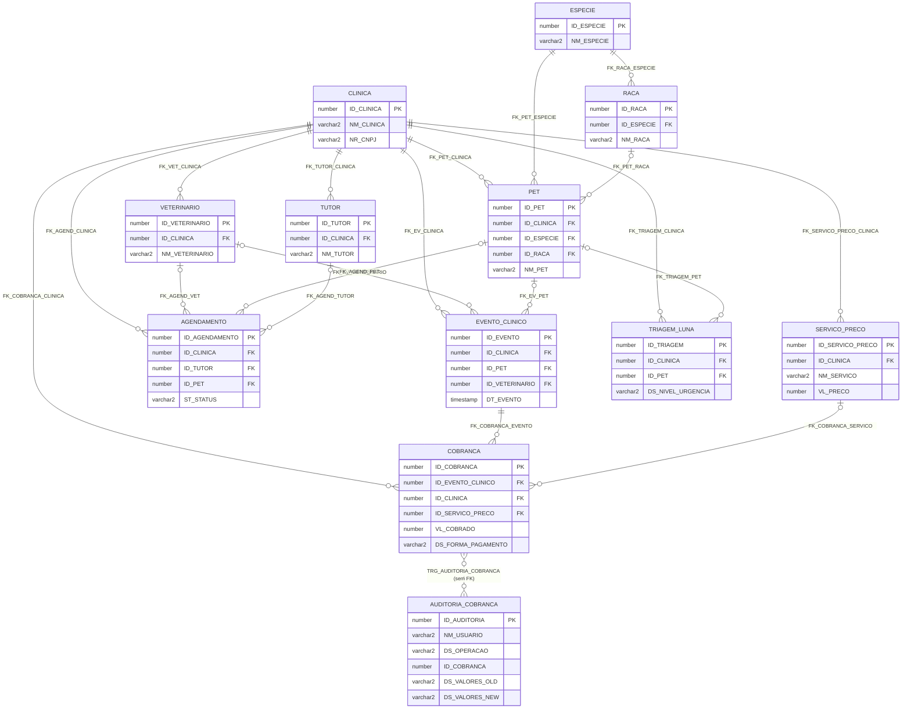

-555)

## Kura · Banco de Dados Oracle

KURA é um sistema de gestão de continuidade veterinária desenvolvido para a **Clyvo Vet** como parte do Challenge FIAP 2026. O banco Oracle 19c opera no padrão **Shared Database**, servindo simultaneamente dois backends independentes: o **Backend Clínica** (.NET, responsável pelo prontuário eletrônico, IoT e IA) e o **Backend Tutor** (Java, responsável por identidade, agendamentos e conformidade LGPD). Regras estritas de *ownership* de escrita por domínio evitam concorrência descontrolada, enquanto leitura cruzada entre serviços é permitida via views e entidades `@Immutable`. O schema foi projetado em 3ª Forma Normal (3FN), com constraints nomeadas, sequences Oracle e suporte nativo a `GenerationType.IDENTITY` do Hibernate 6.

### Sobre o arquivo de entrega

O schema real do KURA é mantido por **19 migrations Flyway** no repositório `backend-tutor-java`. O arquivo **`src/2TDSPF_2026_CodigoSql_Integrantes.sql`** é a **consolidação dessas 19 migrations num único script executável**: cada tabela já nasce no estado final (estado da migration **V19**), com todas as ~75 alterações posteriores (`ALTER TABLE`) já aplicadas inline — **mais** os objetos PL/SQL e a tabela de auditoria exigidos pela Sprint 3.

O script é **re-executável**: o BLOCO 1 (limpeza idempotente) derruba, **por nome**, apenas os objetos do KURA — nunca um `DROP` genérico —, porque o schema de aluno da FIAP é **compartilhado entre várias disciplinas**. Nenhuma credencial, host ou connection string aparece no arquivo; toda a carga do BLOCO 7 é fictícia e declarada como tal.

### Sprint 4 em uma página

A Sprint 4 **soma** quatro coisas à entrega da Sprint 3, sem alterá-la:

1. **Empacotamento** (`src/2TDSPF_2026_Packages_Integrantes.sql`): as rotinas viram quatro packages (`PKG_KURA_LOG`, `PKG_TRIAGEM`, `PKG_COBRANCA`, `PKG_AUDITORIA`) e a trigger passa a ser fina. Saída de emergência: `src/2TDSPF_2026_Packages_Remover.sql`.
2. **Integração**: a API .NET do KURA chama dois procedimentos do `PKG_COBRANCA` (`listar_json` e `relatorio_json`), sempre com a clínica do usuário autenticado.
3. **Exportação JSON** (`scripts/2TDSPF_2026_Exportar_Json.sql` → `data/2TDSPF_2026_Dataset_Cobrancas.json`), gerada pelo próprio package.
4. **MongoDB** (`mongo/2TDSPF_2026_MongoDB_Integrantes.js`): importação, `$jsonSchema`, índices e o relatório da Sprint 3 refeito como agregação.

O arquivo da Sprint 3 (`src/2TDSPF_2026_CodigoSql_Integrantes.sql`), o PDF e os modelos lógico e relacional **continuam exatamente como foram entregues**; as seções da Sprint 3 abaixo ficam como histórico.

> **Onde a Sprint 4 foi provada.** Em um **Oracle XE 21c local (Docker)**, com o schema do produto criado pelo Flyway, e com a API .NET rodando em container contra ele. **Não** foi provada no Oracle do Azure: a instalação dos packages lá ainda não foi executada. Detalhes e limites na seção [Arquitetura de execução](#arquitetura-de-execução).

> **Sobre a contagem de migrations.** O texto da Sprint 3 abaixo fala em 19 migrations (estado V19). O produto hoje aplica **22 migrations (V1 a V23, sem a V20)**. As migrations V20 a V23 não tocam `COBRANCA`, `SERVICO_PRECO` nem `LOG_ERRO` (busca por esses nomes nos cinco arquivos: 0 ocorrências nas migrations; o mesmo comando acha 1 em um teste, usado como controle positivo), então o recorte da Sprint 3 segue compatível com o banco do produto.

---

## Sumário

- [Arquitetura](#arquitetura)
  - [Domínios e Propriedade das Tabelas](#domínios-e-propriedade-das-tabelas)
  - [Estratégia de Chave Primária](#estratégia-de-chave-primária)
  - [Arquitetura de execução](#arquitetura-de-execução)
- [Estrutura do Schema](#estrutura-do-schema)
  - [Blocos do arquivo](#blocos-do-arquivo)
  - [Tabelas (30)](#tabelas-30)
  - [Sequences (29 + 1)](#sequences-29--1)
  - [Índices (13 + 2)](#índices-13--2)
  - [Views (2)](#views-2)
- [Objetos PL/SQL da Sprint 3](#objetos-plsql-da-sprint-3) (histórico: o que foi entregue na Sprint 3)
  - [Função 1 — `FN_COBRANCA_JSON`](#função-1--fn_cobranca_json)
  - [Função 2 — `FN_CALCULAR_SCORE_URGENCIA`](#função-2--fn_calcular_score_urgencia)
  - [Procedimento 1 — `PRC_LISTAR_COBRANCAS_JSON`](#procedimento-1--prc_listar_cobrancas_json)
  - [Procedimento 2 — `PRC_RELATORIO_COBRANCAS`](#procedimento-2--prc_relatorio_cobrancas)
  - [Gatilho — `TRG_AUDITORIA_COBRANCA` + `AUDITORIA_COBRANCA`](#gatilho--trg_auditoria_cobranca--auditoria_cobranca)
- [Sprint 4 — Empacotamento](#sprint-4--empacotamento)
  - [Os quatro packages e a trigger fina](#os-quatro-packages-e-a-trigger-fina)
  - [Por que a trigger fica fora do package](#por-que-a-trigger-fica-fora-do-package)
  - [Mapa: objeto da Sprint 3 → rotina do package](#mapa-objeto-da-sprint-3--rotina-do-package)
  - [Decisões de projeto dos packages](#decisões-de-projeto-dos-packages)
  - [Códigos de saída do instalador](#códigos-de-saída-do-instalador)
- [Modelo de Tratamento de Erros](#modelo-de-tratamento-de-erros)
  - [Sprint 4 — transação autônoma e códigos próprios](#sprint-4--transação-autônoma-e-códigos-próprios)
- [Integração com o Backend (.NET)](#integração-com-o-backend-net)
- [Exportação JSON](#exportação-json)
- [MongoDB](#mongodb)
- [Pré-requisitos](#pré-requisitos)
- [Como Executar](#como-executar)
  - [Sprint 4: ordem de execução](#sprint-4-ordem-de-execução)
- [Re-execução e Limpeza](#re-execução-e-limpeza)
  - [Sprint 4: reinstalar, remover e recomeçar](#sprint-4-reinstalar-remover-e-recomeçar)
- [Diagrama Entidade-Relacionamento](#diagrama-entidade-relacionamento)
- [Variáveis de Ambiente / Conexão](#variáveis-de-ambiente--conexão)
- [Documentação](#documentação)
- [Vídeo da Sprint 4](#vídeo-da-sprint-4)
- [Equipe](#equipe)
- [Licença](#licença)

---

## Arquitetura

### Domínios e Propriedade das Tabelas

| Domínio | Tabelas |
|---------|---------|
| **.NET (Backend Clínica)** | `CLINICA`, `ESPECIE`, `TIPO_EVENTO`, `MEDICAMENTO`, `RACA`, `VETERINARIO`, `TUTOR`, `DISPOSITIVO_IOT`, `SERVICO_PRECO`, `PET`, `INVITE_TUTOR`, `USUARIO_CLINICA`, `LEITURA_TEMPERATURA`, `INTERACAO_CANAL`, `NOTIFICACAO`, `TUTOR_PET`, `EVENTO_CLINICO`, `ALERTA_TEMPERATURA`, `TRIAGEM_LUNA`, `CONSULTA`, `EXAME`, `VACINA`, `PRESCRICAO`, `DOCUMENTO`, `COBRANCA` |
| **Java (Backend Tutor)** | `CONTA_TUTOR`, `CONSENTIMENTO`, `IDEMPOTENCY_KEY` |
| **Shared-write** | `AGENDAMENTO` (Java cria/edita/cancela; .NET atualiza `ST_STATUS`) |
| **Auditoria (compartilhada)** | `LOG_ERRO`, `AUDITORIA_COBRANCA` *(objeto acadêmico da Sprint 3 — não vira migration Flyway)* |

**Leitura cruzada:**
- .NET lê `CONTA_TUTOR`, `CONSENTIMENTO`, `AGENDAMENTO`
- Java lê `INVITE_TUTOR`, `TUTOR`, `PET`, `VETERINARIO`, `CLINICA`, `ESPECIE`, `RACA` via entidades `@Immutable`

A tabela `AGENDAMENTO` é **shared-write**: Java cria, edita e cancela; .NET atualiza `ST_STATUS` via PATCH. O campo `NR_VERSION` implementa Optimistic Locking (`@Version` do JPA/Hibernate) — conflito de versão resulta em `ORA-00001` tratado como HTTP 409.

### Estratégia de Chave Primária

O schema adota — **fiel ao banco real, sem uniformização** — duas estratégias de PK diferenciadas por domínio:

| Estratégia | Nº de tabelas | Tabelas | Motivo |
|-----------|:---:|---------|--------|
| `DEFAULT SEQ_xxx.NEXTVAL` | 26 | Todas as tabelas .NET-owned | Sequências Oracle geradas no lado do banco (migration V12). Sintaxe `DEFAULT SEQ.NEXTVAL` exige Oracle 12c+ |
| `GENERATED BY DEFAULT AS IDENTITY` | 4 | `CONTA_TUTOR`, `CONSENTIMENTO`, `IDEMPOTENCY_KEY`, `AGENDAMENTO` | Padrão Java-owned. `AGENDAMENTO` é `IDENTITY` no banco **e** puxa de `SEQ_AGENDAMENTO` pela entidade JPA (`GenerationType.SEQUENCE`) — as duas coisas coexistem porque `GENERATED BY DEFAULT` (≠ `GENERATED ALWAYS`) aceita valor explícito |

> `TUTOR_PET` tem PK composta `(ID_TUTOR, ID_PET)` — sem sequence.

### Arquitetura de execução

A arquitetura de nuvem do produto é: três Web Apps (App Service) — API da clínica (.NET), API do tutor (Java) e a Luna (Python) —, dois Static Web Apps e **uma VM privada** com **Oracle XE 21c e MongoDB 7 em containers** (portas 1521 e 27017 acessíveis só a partir da subnet dos Web Apps; sem SSH). A descrição completa está no repositório `DevOps-Cloud` (`docs/ARQUITETURA.md`).

```
Static Web Apps (clínica · tutor) ──HTTPS──► App Service
                                             ├─ API da clínica (.NET)  ──┐
                                             ├─ API do tutor (Java, Flyway)
                                             └─ Luna (Python)            │
                                                                         ▼
                            VM privada ── Oracle XE 21c, schema KURA  ◄── onde os packages devem morar
                                       └─ MongoDB 7 (base do produto, kura_docs)
```

Consequências para esta entrega:

- **O schema da aplicação é `KURA`.** A rubrica pede "a mesma base de dados relacional usada pelo backend"; por isso os packages são instalados nesse schema, e não em um schema de aluno à parte. Quem cria as tabelas é o Flyway (migrations do `backend-tutor-java`).
- **O instalador dos packages é não destrutivo** (só cria ou troca objetos PL/SQL e cria `AUDITORIA_COBRANCA` se ela não existir). O arquivo da Sprint 3 **não** pode ser executado nesse schema: o BLOCO 1 dele derruba as 30 tabelas. Ver [Re-execução e Limpeza](#re-execução-e-limpeza).
- **A trigger instalada no schema da aplicação dispara em todo `INSERT`/`UPDATE`/`DELETE` de `COBRANCA` feito pela API.** Por isso existe a ordem de instalação sem janela e a saída de emergência (`2TDSPF_2026_Packages_Remover.sql`).
- **O MongoDB da disciplina é separado do MongoDB do produto**: um `mongo:7` local, base `kura_disciplina`. A base `kura_docs` do produto não é tocada.

**O que foi provado, e onde:**

| Alegação | Onde foi medida |
|---|---|
| 4 packages e a trigger instalam e ficam `VALID`; a demonstração embutida termina em `RESUMO: n OK, 0 FALHOU` | Oracle XE 21c local, schema `KURA` criado pelo Flyway (22 migrations), com e sem dados; e no schema da carga da Sprint 3 |
| A API .NET chama `listar_json` e `relatorio_json`, escopadas pela clínica do JWT, com duas clínicas | Oracle XE 21c local; API construída de `backend-clinica-dotnet@7167076` em container |
| JSON do package = arquivo versionado = entrada do `mongoimport`; `countDocuments` = `COUNT(*)`; agregação = relatório da Sprint 3 | Oracle XE 21c local e `mongo:7` local |
| Suíte automatizada da .NET (1435 testes, 0 falhas em `7167076`) | **InMemory: não executa PL/SQL.** Não é prova de Oracle |
| Instalação dos packages no Oracle da VM do Azure | **Não executada** |
| Vídeo demonstrativo | Ver [Vídeo da Sprint 4](#vídeo-da-sprint-4) |

---

## Estrutura do Schema

### Blocos do arquivo

| Bloco | Conteúdo |
|:---:|---|
| 0 | Cabeçalho e configuração de sessão (`SET SERVEROUTPUT ON SIZE UNLIMITED`, `SET DEFINE OFF`, `LINESIZE 400`…) |
| 1 | Limpeza idempotente — `DROP` dos objetos KURA, **por nome** |
| 2 | **29 sequences** (`START WITH 100 INCREMENT BY 1`) |
| 3 | **30 tabelas** (estado V19), em ordem topológica de dependência de FK (5 níveis) |
| 4 | **13 índices** explícitos (além dos de PK/UNIQUE) |
| 5 | **2 views** |
| 6 | Tabela de auditoria da Sprint 3 — `AUDITORIA_COBRANCA` + `SEQ_AUDITORIA_COBRANCA` + 2 índices |
| 7 | Carga de dados — **≥ 5 registros por tabela**, fictícios |
| 8 | **Funções** — `FN_COBRANCA_JSON`, `FN_CALCULAR_SCORE_URGENCIA` |
| 9 | **Procedimentos** — `PRC_LISTAR_COBRANCAS_JSON`, `PRC_RELATORIO_COBRANCAS` |
| 10 | **Trigger** — `TRG_AUDITORIA_COBRANCA` |
| 11 | Bloco de demonstração — caminho feliz + cada exceção tratada |

### Tabelas (30)

Ordenadas por nível de dependência de FK (ordem de criação no BLOCO 3).

| # | Tabela | PK | Domínio | Descrição |
|:--:|--------|----|---------|-----------|
| 1 | `CLINICA` | `ID_CLINICA` (SEQ) | .NET | Clínicas veterinárias. Raiz do isolamento multi-tenant. |
| 1 | `ESPECIE` | `ID_ESPECIE` (SEQ) | .NET | Espécies animais (Cão, Gato…). Catálogo de baixa mutabilidade. |
| 1 | `TIPO_EVENTO` | `ID_TIPO_EVENTO` (SEQ) | .NET | Catálogo de tipos de evento clínico. `CD_TIPO` = chave de negócio. |
| 1 | `MEDICAMENTO` | `ID_MEDICAMENTO` (SEQ) | .NET | Catálogo central de medicamentos para prescrições. |
| 1 | `LOG_ERRO` | `ID_LOG` (SEQ) | Auditoria | Log de erros de procedures Oracle. Sem FKs intencionalmente. |
| 1 | `IDEMPOTENCY_KEY` | `ID_IDEMPOTENCY` (IDENTITY) | Java | Garantia exactly-once para POSTs sensíveis. TTL 24h. |
| 2 | `RACA` | `ID_RACA` (SEQ) | .NET | Raças por espécie. |
| 2 | `VETERINARIO` | `ID_VETERINARIO` (SEQ) | .NET | Veterinários vinculados à clínica. `UK_VET_CLINICA_ID` (V19) sustenta a FK composta anti cross-tenant de `USUARIO_CLINICA`. |
| 2 | `TUTOR` | `ID_TUTOR` (SEQ) | .NET | Responsável pelo pet. Java lê via `@Immutable`. |
| 2 | `DISPOSITIVO_IOT` | `ID_DISPOSITIVO` (SEQ) | .NET | Sensores IoT de temperatura por clínica. |
| 2 | `SERVICO_PRECO` | `ID_SERVICO_PRECO` (SEQ) | .NET | Catálogo de preços da clínica (migration V18). Alterar `VL_PRECO` não reescreve cobrança já lançada. |
| 3 | `PET` | `ID_PET` (SEQ) | .NET | Animal atendido. `ID_PET` = prontuário único do paciente. |
| 3 | `INVITE_TUTOR` | `ID_INVITE` (SEQ) | .NET | Convite gerado pelo .NET, consumido 1× pelo Java. |
| 3 | `CONSENTIMENTO` | `ID_CONSENTIMENTO` (IDENTITY) | Java | Histórico LGPD art. 7º, I. Somente INSERT — nunca UPDATE. |
| 3 | `USUARIO_CLINICA` | `ID_USUARIO_CLINICA` (SEQ) | .NET | Identidade individual do lado clínico (migration V17). FK composta com `VETERINARIO` recusa vet de outra clínica. |
| 3 | `LEITURA_TEMPERATURA` | `ID_LEITURA` (SEQ) | .NET | Séries temporais de temperatura/umidade por dispositivo IoT. |
| 3 | `INTERACAO_CANAL` | `ID_INTERACAO_CANAL` (SEQ) | .NET | Interação de canal registrada pela Luna (migration V15). `ID_CLINICA` nullable = origem não identificada. |
| 3 | `NOTIFICACAO` | `ID_NOTIFICACAO` (SEQ) | .NET | Notificações internas da clínica (tutor e/ou veterinário). |
| 4 | `TUTOR_PET` | `(ID_TUTOR, ID_PET)` | .NET | Vínculo N:N tutores ↔ pets. `ST_PRINCIPAL='S'` = quem recebe notificações. |
| 4 | `CONTA_TUTOR` | `ID_CONTA` (IDENTITY) | Java | Credenciais de acesso ao portal do tutor. Criada no fluxo `register-invite`. |
| 4 | `EVENTO_CLINICO` | `ID_EVENTO` (SEQ) | .NET | Núcleo da timeline clínica. Entidade completa desde a V9. |
| 4 | `ALERTA_TEMPERATURA` | `ID_ALERTA` (SEQ) | .NET | Alertas por leitura IoT fora da faixa. |
| 4 | `TRIAGEM_LUNA` | `ID_TRIAGEM` (SEQ) | .NET | Triagens da IA Luna. `DS_NIVEL_URGENCIA` é o destino da `FN_CALCULAR_SCORE_URGENCIA`. |
| 5 | `AGENDAMENTO` | `ID_AGENDAMENTO` (IDENTITY + SEQ) | Java / Shared | Shared-write. `NR_VERSION` = optimistic locking (409). |
| 5 | `CONSULTA` | `ID_CONSULTA` (SEQ) | .NET | Detalhe de consulta. Relação 1:1 com `EVENTO_CLINICO`. |
| 5 | `EXAME` | `ID_EXAME` (SEQ) | .NET | Resultado de exame vinculado a um evento clínico. |
| 5 | `VACINA` | `ID_VACINA` (SEQ) | .NET | Aplicação de vacina vinculada a um evento clínico. |
| 5 | `PRESCRICAO` | `ID_PRESCRICAO` (SEQ) | .NET | Prescrição de medicamento vinculada a um evento clínico. |
| 5 | `DOCUMENTO` | `ID_DOCUMENTO` (SEQ) | .NET | Metadados de documento (PDF, imagem) vinculado a um evento. |
| 5 | `COBRANCA` | `ID_COBRANCA` (SEQ) | .NET | Lançamento financeiro (migration V18). **Tabela de fatos da Sprint 3.** `VL_COBRADO` é `NUMBER(10,2)` — cópia do valor no lançamento. |

**Tabela de auditoria da Sprint 3 (BLOCO 6 — não é migration Flyway):**

| Tabela | PK | Descrição |
|--------|----|-----------|
| `AUDITORIA_COBRANCA` | `ID_AUDITORIA` (SEQ) | Trilha de auditoria DML de `COBRANCA`. Preenchida exclusivamente por `TRG_AUDITORIA_COBRANCA`. Sem FK para `COBRANCA` (auditar `DELETE` com FK ativa seria autocontraditório). |

### Sequences (29 + 1)

Todas criadas com `START WITH 100 INCREMENT BY 1` — convenção herdada das migrations V1/V12: fica acima do maior ID dos seeds de desenvolvimento e das linhas de produção.

| Grupo | Sequences |
|-------|-----------|
| .NET-owned (tabelas V1, migration V12) | `SEQ_CLINICA`, `SEQ_ESPECIE`, `SEQ_TIPO_EVENTO`, `SEQ_RACA`, `SEQ_VETERINARIO`, `SEQ_TUTOR`, `SEQ_PET`, `SEQ_INVITE_TUTOR`, `SEQ_EVENTO_CLINICO` |
| .NET-owned (tabelas V9, migration V12) | `SEQ_MEDICAMENTO`, `SEQ_NOTIFICACAO`, `SEQ_DISPOSITIVO_IOT`, `SEQ_LEITURA_TEMP`, `SEQ_ALERTA_TEMP`, `SEQ_TRIAGEM_LUNA`, `SEQ_EXAME`, `SEQ_VACINA`, `SEQ_PRESCRICAO`, `SEQ_DOCUMENTO`, `SEQ_CONSULTA` |
| Auditoria (V13) | `SEQ_LOG_ERRO` |
| Canal (V15) | `SEQ_INTERACAO_CANAL` |
| Identidade clínica (V17) | `SEQ_USUARIO_CLINICA` |
| Módulo financeiro (V18) | `SEQ_SERVICO_PRECO`, `SEQ_COBRANCA` |
| Java-owned (V1) | `SEQ_CONTA_TUTOR` ⚠️, `SEQ_CONSENTIMENTO` ⚠️, `SEQ_AGENDAMENTO`, `SEQ_IDEMPOTENCY_KEY` ⚠️ |
| **Sprint 3 (BLOCO 6)** | `SEQ_AUDITORIA_COBRANCA` — `START WITH 1 … NOCACHE NOCYCLE` |

> ⚠️ **`SEQ_CONTA_TUTOR`, `SEQ_CONSENTIMENTO` e `SEQ_IDEMPOTENCY_KEY` são órfãs de propósito** — as tabelas usam `GENERATED BY DEFAULT AS IDENTITY` e ninguém puxa dessas sequences. Existem no banco real (migration V1) e são mantidas por fidelidade. **`SEQ_AGENDAMENTO` NÃO é órfã**: a entidade JPA `Agendamento.java` puxa dela.

### Índices (13 + 2)

Além dos índices que o Oracle cria sozinho para PK e `UNIQUE`.

| Índice | Tabela | Colunas | Origem |
|--------|--------|---------|:---:|
| `IDX_AGEND_TUTOR` | `AGENDAMENTO` | `ID_TUTOR` | V1 |
| `IDX_AGEND_PET` | `AGENDAMENTO` | `ID_PET` | V1 |
| `IDX_AGEND_DT` | `AGENDAMENTO` | `DT_AGENDAMENTO` | V1 |
| `IDX_CONSENT_TUTOR` | `CONSENTIMENTO` | `(ID_TUTOR, DS_TIPO)` | V1 |
| `IDX_PET_ESPECIE` | `PET` | `ID_ESPECIE` | V1 |
| `IDX_PET_RACA` | `PET` | `ID_RACA` | V1 |
| `IDX_IDEMPOT_CRIACAO` | `IDEMPOTENCY_KEY` | `DT_CRIACAO` | V2 — otimiza o `DELETE` em lote do TTL |
| `IDX_INVITE_TOKEN_ATIVO` | `INVITE_TUTOR` | `(NR_TOKEN, ST_UTILIZADO, ST_ATIVO)` | V3 — busca de invite por token/estado |
| `IDX_AGEND_EVENTO` | `AGENDAMENTO` | `ID_EVENTO_GERADO` | V5 — FK filha sem índice = varredura no lock |
| `IDX_LOG_DATA` | `LOG_ERRO` | `DT_ERRO DESC` | V13 |
| `IDX_LOG_PROCEDURE` | `LOG_ERRO` | `NM_PROCEDURE` | V13 |
| `IDX_COBRANCA_CLINICA_DATA` | `COBRANCA` | `(ID_CLINICA, DT_COBRANCA)` | V18 — "por clínica e por período" |
| `IDX_COBRANCA_EVENTO` | `COBRANCA` | `ID_EVENTO_CLINICO` | V18 — "cobranças deste atendimento" |
| `IDX_AUDITORIA_COB_DATA` | `AUDITORIA_COBRANCA` | `DT_OPERACAO DESC` | Sprint 3 |
| `IDX_AUDITORIA_COB_REG` | `AUDITORIA_COBRANCA` | `ID_COBRANCA` | Sprint 3 |

### Views (2)

Versão consolidada = a da migration V6 (aliases renomeados para os nomes canônicos das entidades Java).

| View | Tabelas-fonte | Propósito | Consumidor |
|------|--------------|-----------|------------|
| `VW_TIMELINE_PET` | `AGENDAMENTO`, `PET`, `CLINICA` | Linha do tempo de atendimentos por pet, com aliases V6 (`ID_EVENTO`, `DT_EVENTO`). Filtra `ID_PET IS NOT NULL`. | Java `TimelineService` |
| `VW_VACINAS_VENCENDO` | `AGENDAMENTO`, `PET`, `CLINICA` | Vacinas agendadas (`DS_TIPO = 'VACINA'`) nos próximos 30 dias, não canceladas nem realizadas. `INTERVAL '30' DAY`. | Luna (alertas preventivos) |

---

## Objetos PL/SQL da Sprint 3

> **Histórico (Sprint 3).** Esta seção descreve os cinco objetos **como foram entregues na Sprint 3** e como existem em `src/2TDSPF_2026_CodigoSql_Integrantes.sql`. Na Sprint 4 as quatro rotinas viram membros de packages e a trigger fica fina — ver [Sprint 4 — Empacotamento](#sprint-4--empacotamento) e o mapa [objeto da Sprint 3 → rotina do package](#mapa-objeto-da-sprint-3--rotina-do-package). Instalar o arquivo de packages sobre o schema da Sprint 3 **remove** as versões standalone (BLOCO 9 do instalador).

Os cinco objetos **não são cinco exercícios isolados** — são um recorte do sistema, todo girando em torno da tabela de fatos **`COBRANCA`**:

```
                 SERVICO_PRECO ──┐
                                 │ (catálogo de preços)
   CLINICA ──── EVENTO_CLINICO ──┴── COBRANCA ──────────► FN_COBRANCA_JSON  ─► PRC_LISTAR_COBRANCAS_JSON
                                        │  ▲                       │
                                        │  │ (mesma função)        │
                                        ▼  └───────────────────────┘
                              TRG_AUDITORIA_COBRANCA ─► AUDITORIA_COBRANCA
                                        ▲
                              PRC_RELATORIO_COBRANCAS (agrega COBRANCA)

   INTERACAO_CANAL ──► TRIAGEM_LUNA.DS_NIVEL_URGENCIA ◄── FN_CALCULAR_SCORE_URGENCIA
```

| Objeto | Tipo | Assinatura | Pts |
|--------|------|------------|:---:|
| `FN_COBRANCA_JSON` | Função | `(p_id_cobranca, p_id_evento, p_id_clinica, p_id_servico, p_vl_cobrado, p_ds_forma, p_dt_cobranca, p_st_ativa) RETURN VARCHAR2` | 15 |
| `FN_CALCULAR_SCORE_URGENCIA` | Função | `(p_texto IN VARCHAR2) RETURN VARCHAR2` → `'ALTA'` / `'MEDIA'` / `'BAIXA'` | 15 |
| `PRC_LISTAR_COBRANCAS_JSON` | Procedimento | `(p_id_clinica IN NUMBER DEFAULT NULL)` | 15 |
| `PRC_RELATORIO_COBRANCAS` | Procedimento | `(p_id_clinica IN NUMBER DEFAULT NULL)` | 15 |
| `TRG_AUDITORIA_COBRANCA` | Gatilho | `AFTER INSERT OR UPDATE OR DELETE ON COBRANCA FOR EACH ROW` | 30 |

### Função 1 — `FN_COBRANCA_JSON`

Recebe os **campos escalares de uma cobrança** e devolve uma **string JSON válida**, construída 100% à mão (concatenação + escape próprio). **Não usa** `JSON_OBJECT`, `JSON_ARRAY`, `TO_JSON`, `JSON_TABLE` nem similar.

- **Assinatura escalar de propósito:** a trigger `FOR EACH ROW` sobre `COBRANCA` **não pode consultar `COBRANCA`** (`ORA-04091`, tabela mutante). A função recebe os 8 valores escalares e só consulta `SERVICO_PRECO` (que a trigger não toca).
- **Escape manual, ordem importa:** troca `\` por `\\` **antes** de `"` por `\"`.
- **`NULL` vira o literal `null`**, sem aspas — `ID_SERVICO_PRECO` e `DS_FORMA_PAGAMENTO` são nullable.
- **Ponto decimal forçado:** a sessão FIAP é pt-BR (`NLS_NUMERIC_CHARACTERS = ',.'`); força-se `'.,'` no `TO_CHAR` para não emitir `{"valor": 12,5}` (JSON inválido).
- **Data em ISO-8601 estável:** `TO_CHAR(p_dt_cobranca, 'YYYY-MM-DD"T"HH24:MI:SS')`.
- **3 exceções:** `NO_DATA_FOUND`, `VALUE_ERROR`, `OTHERS` — **sempre** devolve um JSON de fallback, **nunca** propaga (chamada pela trigger). **Não grava em `LOG_ERRO`** — `COMMIT` dentro de trigger é `ORA-04092`.

### Função 2 — `FN_CALCULAR_SCORE_URGENCIA`

Traz para o banco o **motor de triagem léxico da Luna** (hoje em `kura-luna-ai/luna/src/ai/triage_engine.py` + `triage_rules.py`), portado 1:1. O nível calculado é gravado em `TRIAGEM_LUNA.DS_NIVEL_URGENCIA`.

- Pontuação: `ALTA = 10`, `MEDIA = 3`, `BAIXA = 1`. Três níveis, nessa ordem de prioridade.
- Texto **normalizado** (minúsculas + remoção de acento, via `TRANSLATE`/`UNISTR`); casamento por **substring** (`INSTR > 0`), sem fronteira de palavra — igual ao `if _normalize(kw) in normalized_text` do Python.
- O **score acumula** os pontos de todos os níveis com match; o **nível retornado** é o primeiro (ALTA > MEDIA > BAIXA) com qualquer match. Sem match / texto vazio ⇒ `'BAIXA'`.
- **3 exceções:** `e_texto_excede_limite` (texto > 4000 caracteres — a *verificação de limites*), `VALUE_ERROR`, `OTHERS`. Em erro: grava `LOG_ERRO` e **retorna `'BAIXA'`** (coluna destino é `NOT NULL`).
- ⚠️ Grava DML no tratamento de erro ⇒ deve ser chamada **de dentro de PL/SQL** (atribuição a variável), nunca embutida num `SELECT` ou no `SET` de um `UPDATE` (`ORA-14551`).

### Procedimento 1 — `PRC_LISTAR_COBRANCAS_JSON`

Percorre um **cursor explícito com JOIN de 3 tabelas** (`COBRANCA` + `CLINICA` + `LEFT JOIN SERVICO_PRECO`), chama `FN_COBRANCA_JSON` por linha e imprime **um objeto JSON por linha** com `DBMS_OUTPUT.PUT_LINE`, agrupado por clínica.

- `LEFT JOIN` em `SERVICO_PRECO` proposital (`ID_SERVICO_PRECO` é nullable).
- Um JSON por linha porque `DBMS_OUTPUT.PUT_LINE` aborta acima de 32.767 bytes/linha.
- **3 exceções:** `NO_DATA_FOUND`, `VALUE_ERROR`, `OTHERS`. Chamada direta ⇒ grava em `LOG_ERRO` (`ROLLBACK` → `INSERT LOG_ERRO` → `COMMIT` → `DBMS_OUTPUT`).

### Procedimento 2 — `PRC_RELATORIO_COBRANCAS`

Lê a tabela de fatos `COBRANCA` e imprime um relatório totalizado com **três níveis**: soma por combinação `(ID_CLINICA, DS_FORMA_PAGAMENTO)` → **`Sub Total`** por clínica → **`Total Geral`**.

- **Soma 100% manual:** o cursor traz linhas de detalhe, **sem `GROUP BY`, sem `SUM()`, sem `ROLLUP`/`CUBE`/`GROUPING SETS`/`GROUPING`** (proibidos pela rubrica). Toda totalização em **3 acumuladores PL/SQL** por quebra de grupo.
- **O último grupo é emitido fora do `LOOP`** — não há próxima iteração para detectar a última quebra.
- **Formato fixo:** larguras fixas, ASCII puro; a coluna numérica termina no mesmo offset nas três formas de linha; nas linhas de total as colunas categóricas ficam literalmente vazias.
- **3 exceções:** `NO_DATA_FOUND`, `VALUE_ERROR`, `OTHERS` — mesmo padrão do Procedimento 1.

### Gatilho — `TRG_AUDITORIA_COBRANCA` + `AUDITORIA_COBRANCA`

**Tabela de auditoria (BLOCO 6):**

| Coluna | Tipo | Conteúdo |
|--------|------|----------|
| `ID_AUDITORIA` | `NUMBER(15)` | PK — `DEFAULT SEQ_AUDITORIA_COBRANCA.NEXTVAL` |
| `NM_USUARIO` | `VARCHAR2(60)` NOT NULL | `USER` do banco (quem) |
| `DS_OPERACAO` | `VARCHAR2(10)` NOT NULL | `INSERT` \| `UPDATE` \| `DELETE` (+ `CHECK`) |
| `DT_OPERACAO` | `TIMESTAMP` NOT NULL | `DEFAULT SYSTIMESTAMP` (quando) |
| `ID_COBRANCA` | `NUMBER(10)` | PK do registro afetado — **sem FK**, de propósito |
| `DS_VALORES_OLD` | `VARCHAR2(4000)` | `:OLD` serializado por `FN_COBRANCA_JSON` — nulo em `INSERT` |
| `DS_VALORES_NEW` | `VARCHAR2(4000)` | `:NEW` serializado por `FN_COBRANCA_JSON` — nulo em `DELETE` |

**Trigger (BLOCO 10):** cabeçalho `AFTER INSERT OR UPDATE OR DELETE ON COBRANCA FOR EACH ROW`.

- `INSERTING` / `UPDATING` / `DELETING` definem `DS_OPERACAO`.
- `:OLD` é serializado **só** quando `UPDATING OR DELETING`; `:NEW` **só** quando `INSERTING OR UPDATING`.
- Reusa a **Função 1** para serializar `:OLD`/`:NEW` — custo marginal zero e amarra a entrega numa história só.
- **Sem bloco `EXCEPTION`** de propósito: a rubrica exige ≥ 3 exceções em *procedimentos e funções* (a trigger não está nessa lista), e um `WHEN OTHERS` mudo **esconderia** falha de auditoria. Como `FN_COBRANCA_JSON` já tem `WHEN OTHERS` com fallback, um erro de serialização não derruba o DML de negócio.

## Sprint 4 — Empacotamento

A rubrica pede objetos "empacotados, agrupados de maneira lógica e acessível". O arquivo **`src/2TDSPF_2026_Packages_Integrantes.sql`** agrupa as rotinas por responsabilidade:

```
PKG_KURA_LOG ◄──────── (log de erro, transação autônoma) ◄── usado por todos os outros
PKG_TRIAGEM      fn_calcular_score_urgencia
PKG_COBRANCA     fn_cobranca_json · prc_listar_cobrancas_json · prc_relatorio_cobrancas
                 listar_json · relatorio_json · exportar_todas
PKG_AUDITORIA    registrar_cobranca  ◄── TRG_AUDITORIA_COBRANCA (fora do package, fina)
```

### Os quatro packages e a trigger fina

| Objeto | Interface pública | O que faz |
|---|---|---|
| `PKG_KURA_LOG` | `registrar_erro(p_origem, p_codigo, p_mensagem, p_parametros)` | Grava uma linha em `LOG_ERRO` e a confirma em **transação autônoma** (`PRAGMA AUTONOMOUS_TRANSACTION`). Não propaga erro do próprio `INSERT`; não faz `COMMIT` nem `ROLLBACK` na transação de quem chamou |
| `PKG_TRIAGEM` | `fn_calcular_score_urgencia(p_texto)` → `'ALTA'`/`'MEDIA'`/`'BAIXA'` | O motor léxico de triagem da Sprint 3, portado. Em erro, grava no log e devolve `'BAIXA'` |
| `PKG_COBRANCA` | `fn_cobranca_json` (8 escalares) · `prc_listar_cobrancas_json` e `prc_relatorio_cobrancas` (`DBMS_OUTPUT`, como na Sprint 3) · **`listar_json`** e **`relatorio_json`** (`p_saida OUT CLOB`, chamadas pela aplicação) · `exportar_todas` (`OUT CLOB`, só para o arquivo JSON) | JSON de cobrança e relatório totalizado, com soma manual |
| `PKG_AUDITORIA` | `registrar_cobranca(p_operacao, 8 valores :OLD, 8 valores :NEW)` | Grava a trilha em `AUDITORIA_COBRANCA`, **na mesma transação** do `INSERT`/`UPDATE`/`DELETE` auditado |
| `TRG_AUDITORIA_COBRANCA` | — (fora de package) | `AFTER INSERT OR UPDATE OR DELETE ON COBRANCA FOR EACH ROW`: só identifica a operação e faz **uma** chamada a `PKG_AUDITORIA.registrar_cobranca` |

### Por que a trigger fica fora do package

Um package agrupa "tipos, variáveis, constantes, subprogramas, cursores e exceções" ([Oracle 21c, PL/SQL Language Reference, "What is a Package?"](https://docs.oracle.com/en/database/oracle/oracle-database/21/lnpls/plsql-packages.html)); trigger **não é membro de package**, é uma unidade própria (`CREATE TRIGGER`). Ler a rubrica ao pé da letra ("gatilhos empacotados") é, portanto, impossível. A resposta é a que a própria Oracle recomenda: quando a lógica da trigger passa de umas 60 linhas, ela deve ficar em um subprograma armazenado e a trigger só o chama ([Oracle 21c, "PL/SQL Triggers"](https://docs.oracle.com/en/database/oracle/oracle-database/21/lnpls/plsql-triggers.html)). A trigger fina identifica a operação; toda a regra mora em `PKG_AUDITORIA`.

### Mapa: objeto da Sprint 3 → rotina do package

| Sprint 3 (standalone) | Sprint 4 |
|---|---|
| `FN_COBRANCA_JSON` | `PKG_COBRANCA.fn_cobranca_json` — mesmos campos, mesma ordem, mesmo escape |
| `FN_CALCULAR_SCORE_URGENCIA` | `PKG_TRIAGEM.fn_calcular_score_urgencia` |
| `PRC_LISTAR_COBRANCAS_JSON` | `PKG_COBRANCA.prc_listar_cobrancas_json` (+ a nova `listar_json`, que devolve CLOB em vez de imprimir) |
| `PRC_RELATORIO_COBRANCAS` | `PKG_COBRANCA.prc_relatorio_cobrancas` (+ a nova `relatorio_json`) |
| `TRG_AUDITORIA_COBRANCA` | **mesmo nome**, agora fina; a regra foi para `PKG_AUDITORIA.registrar_cobranca` |
| 9 handlers que repetiam `ROLLBACK` → `INSERT INTO LOG_ERRO` → `COMMIT` | `PKG_KURA_LOG.registrar_erro` (uma rotina, transação autônoma) |

A equivalência com a Sprint 3 foi conferida em execução: o relatório e a listagem saem **iguais byte a byte** aos da Sprint 3 (comparação por `diff` dos arquivos de `SPOOL`), e `fn_cobranca_json` e `fn_calcular_score_urgencia` foram comparadas caso a caso contra as funções da Sprint 3 recriadas com outro nome.

### Decisões de projeto dos packages

- **Sem estado e sem `SERIALLY_REUSABLE`.** A documentação da Oracle diz que acessar um package `SERIALLY_REUSABLE` a partir de trigger de banco gera erro; `PKG_AUDITORIA` e `PKG_COBRANCA` são chamados pela trigger.
- **Só o `PKG_KURA_LOG` é autônomo.** O `PKG_AUDITORIA` fica na transação do chamador: se o lançamento da cobrança sofre `ROLLBACK`, a linha de auditoria some junto (autônoma, ela sobreviveria a um `ROLLBACK` e auditaria algo que não aconteceu).
- **Log inválido não derruba o lançamento de cobrança.** `PKG_COBRANCA` e `PKG_TRIAGEM` chamam o log por SQL dinâmico (`log_seguro`), sem dependência de compilação: com a especificação do `PKG_KURA_LOG` propositalmente inválida, o `UPDATE` em `COBRANCA` continuou funcionando (`rows=1`).
- **Ordem de instalação sem janela.** Packages e trigger entram por `CREATE OR REPLACE` (nunca `DROP`); o BLOCO 8 recompila e confere todos os dependentes (a trigger inclusive) **antes** de o BLOCO 9 remover as rotinas standalone da Sprint 3. Parar o script em qualquer ponto deixa a trigger apontando para código que existe.
- **Nenhuma rotina de negócio faz `COMMIT` ou `ROLLBACK` na transação do chamador.** O único `ROLLBACK` do arquivo está dentro da transação autônoma do log, e encerra só ela.

### Códigos de saída do instalador

O `sqlplus` sai com `SQLCODE` módulo 256; o instalador usa códigos próprios que sobrevivem a isso. Quem automatiza deve decidir por **`EXIT = 0` e nenhum `ORA-` fora da demonstração e `RESUMO: n OK, 0 FALHOU`**.

| `EXIT` | Origem | Significado |
|:---:|---|---|
| 164 | `ORA-20900` | Pré-requisito: faltam tabelas (nada foi criado) |
| 165 | `ORA-20901` | Algum objeto ficou inválido ou com erro de compilação |
| 166 | `ORA-20902` | Pacotes instalados e válidos, mas a demonstração embutida registrou `FALHOU` |
| 167 | `ORA-20903` | O BLOCO 9 recusou remover uma standalone da Sprint 3 da qual algo ainda depende |

---

## Modelo de Tratamento de Erros

Padrão herdado da 2ª Sprint (`banco/kura_req1`): cada handler faz `ROLLBACK` → `INSERT INTO LOG_ERRO (..., SQLCODE, SQLERRM, DS_PARAMETROS)` → `COMMIT` → `DBMS_OUTPUT`. Assim o "print de exceção" deixa de ser texto no console e passa a ser **linha persistida** consultável.

**Estrutura da tabela `LOG_ERRO`:**

| Coluna | Tipo | Descrição |
|--------|------|-----------|
| `ID_LOG` | `NUMBER(15)` | PK — `DEFAULT SEQ_LOG_ERRO.NEXTVAL` |
| `NM_PROCEDURE` | `VARCHAR2(120)` | Nome do objeto que gerou o erro |
| `NM_USUARIO` | `VARCHAR2(60)` | `USER` Oracle no momento do erro |
| `DT_ERRO` | `TIMESTAMP` | `SYSTIMESTAMP` no momento do erro |
| `NR_CODIGO_ERRO` | `NUMBER(10)` | `SQLCODE` (negativo em erros Oracle) |
| `DS_MENSAGEM_ERRO` | `VARCHAR2(2000)` | Prefixo legível + `SQLERRM` |
| `DS_PARAMETROS` | `VARCHAR2(2000)` | Parâmetros da chamada que causou o erro |
| `DS_STACK_TRACE` | `CLOB` | Stack trace completo (opcional) |

> `LOG_ERRO` é criada **sem FKs intencionalmente**: um registro de auditoria jamais deve falhar por violação referencial. Mesmo raciocínio em `AUDITORIA_COBRANCA`.

**Exceções por objeto:**

| Objeto | Exceção 1 | Exceção 2 | Exceção 3 | Grava `LOG_ERRO`? |
|--------|-----------|-----------|-----------|:---:|
| `FN_COBRANCA_JSON` | `NO_DATA_FOUND` | `VALUE_ERROR` | `OTHERS` | **Não** — chamada por trigger (`COMMIT` em trigger é `ORA-04092`) |
| `FN_CALCULAR_SCORE_URGENCIA` | `e_texto_excede_limite` | `VALUE_ERROR` | `OTHERS` | Sim |
| `PRC_LISTAR_COBRANCAS_JSON` | `NO_DATA_FOUND` | `VALUE_ERROR` | `OTHERS` | Sim |
| `PRC_RELATORIO_COBRANCAS` | `NO_DATA_FOUND` | `VALUE_ERROR` | `OTHERS` | Sim |

> `TRG_AUDITORIA_COBRANCA` **não** tem bloco `EXCEPTION` — de propósito (ver seção do gatilho).


### Sprint 4 — transação autônoma e códigos próprios

O padrão acima (`ROLLBACK` → `INSERT` → `COMMIT`) tinha dois problemas quando a rotina passa a ser chamada por uma aplicação: o `ROLLBACK` desfaz o trabalho pendente **de quem chamou**, e o `COMMIT` confirma o trabalho dele pela metade. Na Sprint 4 todo o log passa por **`PKG_KURA_LOG.registrar_erro`**, que usa `PRAGMA AUTONOMOUS_TRANSACTION`: o log tem transação própria e **sobrevive ao `ROLLBACK` do chamador**, sem tocar nele.

Medido (Oracle XE 21c local, schema `KURA`): com uma linha pendente na transação do chamador, duas exceções tratadas (`-20001` em `listar_json` e `-20003` na triagem) gravaram 2 linhas em `LOG_ERRO`; o `LOCAL_TRANSACTION_ID` do chamador foi o mesmo antes e depois, e depois do `ROLLBACK` a linha pendente sumiu **e as 2 linhas de log ficaram**.

**Códigos que a aplicação enxerga** (`RAISE_APPLICATION_ERROR`):

| Código | Situação | Rotina |
|:---:|---|---|
| `-20001` | `p_id_clinica` nulo | `listar_json`, `relatorio_json` |
| `-20002` | clínica inexistente ou inativa | `listar_json`, `relatorio_json` |
| `-20003` | texto de triagem com mais de 4000 caracteres (tratado: devolve `'BAIXA'`; era `-20001` na Sprint 3) | `fn_calcular_score_urgencia` |

**Regra assimétrica de exceção, de propósito:**

| Rotina | Comportamento em erro |
|---|---|
| `listar_json`, `relatorio_json` (chamadas pela aplicação) | grava em `LOG_ERRO` e **relança**, para o backend saber que falhou |
| `prc_listar_cobrancas_json`, `prc_relatorio_cobrancas`, `fn_calcular_score_urgencia` | grava em `LOG_ERRO`, informa e **não propaga** (comportamento da Sprint 3) |
| `fn_cobranca_json` | **nunca propaga** (é chamada pela trigger), devolve um JSON de fallback; também grava em `LOG_ERRO`, o que a Sprint 3 não podia fazer (`COMMIT` em trigger é `ORA-04092`; agora o log é autônomo) |

**LGPD:** o log guarda só identificadores e tamanhos (`p_id_clinica=100`, `len=4001`), nunca o texto da mensagem de triagem. Medido: o texto de teste do cenário de triagem não aparece em `LOG_ERRO` nem no log da API (controle positivo: `len=4001` aparece 7 vezes).

---

## Integração com o Backend (.NET)

A rubrica pede que as procedures sejam "chamadas via aplicação". A API da clínica (`backend-clinica-dotnet`, Clean Architecture) chama o `PKG_COBRANCA` por **ODP.NET** (`OracleCommand` do tipo `StoredProcedure`, `p_id_clinica` como `Int64` de entrada e `p_saida` como `Clob` de saída; o CLOB é lido com a conexão aberta e liberado com `Dispose`; se há transação corrente, a chamada a usa).

### As duas rotas

| Rota (`GET`) | Procedure | Perfil |
|---|---|---|
| `/api/v1/financeiro/cobrancas/exportacao-json` | `PKG_COBRANCA.LISTAR_JSON` | só `GESTOR` |
| `/api/v1/financeiro/cobrancas/relatorio-oracle` | `PKG_COBRANCA.RELATORIO_JSON` | só `GESTOR` |

`VETERINARIO` recebe `403` e requisição sem token recebe `401`.

A rotina de **inserção** não precisou de rota nova: o lançamento de cobrança já existia (`POST /api/v1/eventos-clinicos/{id}/cobrancas`, EF Core) e a **trigger fina** audita cada `INSERT` na mesma transação.

### Escopo de clínica: sempre o do JWT

`p_id_clinica` vem **exclusivamente** da clínica do usuário autenticado (`IClinicaContext`, lida do JWT), nunca de rota nem de query string (`?idClinica=` é ignorado). Na Sprint 3, `NULL` significava "todas as clínicas"; passá-lo pela aplicação seria vazamento entre clínicas. Por isso:

- a interface do gateway só tem métodos que recebem `long idClinica`, e **`PKG_COBRANCA.exportar_todas` não tem método nenhum**: um teste procura o nome da rotina no código-fonte e nos assemblies e falha se achar (com controle positivo do detector);
- a suíte exercita duas clínicas, e a troca do `idClinica` por um valor fixo é pega por falha nominal.

### Mapeamento de erro para HTTP

O corpo da resposta **nunca** carrega `ORA-`, nome de package ou de schema; o detalhe técnico fica só no log do servidor.

| Situação | Origem | HTTP |
|---|---|:---:|
| Sucesso | — | `200` (`application/json`) |
| Clínica inexistente ou inativa | `ORA-20002` | `404` |
| `p_id_clinica` nulo (bug do servidor: a clínica vem do JWT) | `ORA-20001` | `500`, título fixo |
| Package ausente ou inválido | `ORA-04063`, `04067`, `04068`, `06508`, `06550` | `503`, `codigo: ROTINA_ORACLE_INDISPONIVEL`, título fixo |
| Oracle fora do ar (falha ao abrir a conexão) | `ORA-12545` etc. | `500`, título fixo (o processo não cai) |
| `POST` de cobrança com trigger ou package inválidos | `ORA-04063`, `04067`, `04068`, `04098`, `06508`, `06550` no commit | `503` |

### O que foi provado contra Oracle real (local)

API construída de `backend-clinica-dotnet@7167076`, Oracle XE 21c, schema `KURA` migrado pelo Flyway, duas clínicas:

- as duas rotas respondem `200`; a clínica A vê só as suas cobranças e a B só as dela (conjuntos de ids disjuntos, conferidos id a id contra `SELECT`); os subtotais do `relatorio-oracle` batem número a número com `PKG_COBRANCA.prc_relatorio_cobrancas`;
- `POST` de cobrança ⇒ `201` + linha em `COBRANCA` + linha `INSERT` em `AUDITORIA_COBRANCA` com o JSON do `:NEW`;
- package ausente ⇒ `503` sem `ORA-` no corpo (o `ORA-06550` está no log do servidor); corpo do `PKG_AUDITORIA` inválido ⇒ `POST` `503` e nada gravado;
- clínica sem cobrança ⇒ `[]` / `"grupos":[]`; clínica inativa ⇒ `404`; JSON com acento e aspas íntegro; CLOB de 419.520 caracteres íntegro;
- sem vazamento de LOB temporário (`V$TEMPORARY_LOBS` 1 → 1 em 30 chamadas, com controle positivo do instrumento);
- Oracle parado ⇒ `500` de título fixo, processo de pé e recuperação sem reiniciar.

### Limites declarados

- A suíte automatizada da .NET (**1435 testes, 0 falhas** em `7167076`) usa banco **InMemory e não executa PL/SQL**: ela prova o escopo, o mapeamento e o gateway com dublê; **a chamada real ao Oracle só foi provada na execução local acima**.
- Depois de o `Remover.sql` rodar, o `POST` de cobrança continua devolvendo `201`, mas **sem auditoria**, e nada avisa. É o custo declarado da saída de emergência.
- Com o Oracle fora do ar, o `POST` de cobrança (EF Core) ainda devolve `500` com o texto do erro de conexão no `title`: é o ramo genérico do middleware de exceções, anterior a esta entrega e fora das duas rotas novas.
- A função de triagem (`PKG_TRIAGEM`) **não** é exposta pela API nesta entrega.


## Exportação JSON

`scripts/2TDSPF_2026_Exportar_Json.sql` chama **`PKG_COBRANCA.exportar_todas`** e grava o CLOB em `data/2TDSPF_2026_Dataset_Cobrancas.json`. O JSON é gerado **pelo package** (nunca montado nem editado à mão): é a mesma serialização que a trigger e a API usam, e é o arquivo que o `mongoimport --jsonArray` lê.

- **Conteúdo:** array JSON, um elemento por linha, **só cobranças ativas**, UTF-8 sem BOM. Campos, nesta ordem: `idCobranca`, `idEvento`, `idClinica`, `idServico`, `servico` (o **nome**, texto, ou `null`), `valor`, `formaPagamento`, `dataCobranca`, `ativa`, `nmClinica`.
- **Arquivo versionado:** 18 elementos, a carga **fictícia** da Sprint 3. As datas da carga são relativas a `SYSDATE`: o arquivo é o retrato de uma execução.
- **Sem senha no repositório:** o script não tem `CONNECT`; usa a conexão que você abriu. O cliente precisa de `NLS_LANG` com charset UTF-8 (por exemplo `.AL32UTF8`), senão o acento sai errado.
- **Por que `exportar_todas` não é exposta pela API:** ela devolve as cobranças de **todas** as clínicas. É de uso exclusivo desta exportação.

```
# a partir da RAIZ do repositório (o SPOOL é relativo; a pasta data/ precisa existir)
sqlplus USUARIO@//host:porta/servico @scripts/2TDSPF_2026_Exportar_Json.sql
```

Medido: o JSON regerado a partir da carga da Sprint 3 é **idêntico** ao arquivo versionado (`cmp`), é JSON válido (`JSON.parse`) com 18 elementos, todos ativos, e o `COUNT(*)` das cobranças ativas no Oracle também é 18. Executado contra o schema `KURA` com dados de duas clínicas, o mesmo script gerou um array válido com a contagem igual ao `COUNT(*)` das ativas. Se o package não estiver instalado, o script falha (`ORA-06550`, `EXIT=150`) **sem criar o arquivo**.

> ⚠️ Rodar o script na raiz do repositório **sobrescreve** `data/2TDSPF_2026_Dataset_Cobrancas.json`. Para experimentar sem alterar o arquivo versionado, rode-o a partir de uma cópia.


## MongoDB

O dataset exportado é importado em um MongoDB 7, com estrutura de documentos, validação, índice justificado e o relatório da Sprint 3 refeito como agregação. Passo a passo, tabela de seções do script e decisões de modelagem: **[`mongo/README.md`](mongo/README.md)**. O código-fonte é `mongo/2TDSPF_2026_MongoDB_Integrantes.js` (sem credencial; o MongoDB local roda sem autenticação, só para a disciplina).

| Decisão | Por quê |
|---|---|
| **Staging** `cobrancas_raw` (importação crua) → **`cobrancas_export`** (coleção final) por pipeline | O JSON do Oracle traz a data como texto e o valor como número em ponto flutuante; um `$jsonSchema` com `date` e `decimal` recusaria a importação direta. A conversão (`$dateFromString` em UTC, `$toDecimal` sobre `$toString`, sem cauda binária) é feita no `$merge` |
| **`$jsonSchema` estrito** (`validationLevel: strict`, `validationAction: error`, `additionalProperties: false`) | Documento fora do formato é recusado (código 121), não aceito com aviso |
| **Embutir** `clinica.nome` e `servico {id, nome}`; **referenciar** a clínica por `idClinica` | O relatório lê tudo em um documento. `servico.nome` é o nome **na data da exportação** (o Oracle não guarda histórico). Cobrança cresce sem limite e o cadastro da clínica muda sozinho |
| Índices `ux_cobranca_id` (único) e `ix_clinica_data` (`idClinica`, `dtCobranca` desc) | O único é exigido pelo `$merge`; o composto atende "cobranças de uma clínica num período" (`IXSCAN` no `explain`) |
| Espelhamento: depois do `$merge`, apaga do export o que sumiu do staging | O `$merge` só faz upsert; sem isso uma cobrança desativada no Oracle ficaria órfã e o Total Geral ficaria errado |
| Conferências no fim do script (`CONFERE`/`DIVERGE`, `RESUMO`, `EXIT` diferente de zero se divergir) | A demonstração confere, não só imprime |

**Medido (`mongo:7` local, 7.0.45):**

- com o dataset versionado (18 cobranças): `countDocuments` do staging e do export = **18** = `COUNT(*)` das ativas; a agregação reproduz o `PRC_RELATORIO_COBRANCAS` da Sprint 3 — **Sub Total 1565.10 (clínica 1), 1462.05 (clínica 2), Total Geral 3027.15**, em `Decimal128`; `RESUMO: 34 CONFERE, 0 DIVERGE`, `EXIT=0`;
- com o JSON exportado do schema `KURA` (duas clínicas, 5 cobranças): `countDocuments` = 5 = `COUNT(*)`; os subtotais por clínica (250.15 e 390.50) são iguais aos do `relatorio-oracle` da API; `RESUMO: 20 CONFERE, 0 DIVERGE` (o gabarito da Sprint 3 só vale para o dataset da Sprint 3; com outro, o script imprime `PULADO`);
- o `$jsonSchema` recusa documento inválido (por exemplo `valor: "abc"`) com o código 121;
- 2 rodadas seguidas dão o mesmo resultado (idempotente); o `--drop` do `mongoimport` é obrigatório: sem ele cada importação duplica o staging.

---

## Pré-requisitos

| Requisito | Versão mínima | Observação |
|-----------|--------------|------------|
| Oracle Database | 12c (entregue no **19c** da FIAP) | `DEFAULT SEQ.NEXTVAL` e `GENERATED BY DEFAULT AS IDENTITY` exigem 12c+ |
| Oracle SQL Developer | 21.x+ (ou SQLcl) | Recomendado — evita mojibake por `NLS_LANG` mal configurado; necessário para ver o `DBMS_OUTPUT` |
| Usuário Oracle | Qualquer schema de aluno | Necessita `CREATE TABLE`, `CREATE SEQUENCE`, `CREATE PROCEDURE`, `CREATE TRIGGER`, `CREATE VIEW` |
| **Sprint 4** — `sqlplus` | cliente Oracle de linha de comando (ou SQL Developer/SQLcl) | os scripts da Sprint 4 foram feitos para rodar por `sqlplus`; o instalador devolve códigos de saída próprios |
| **Sprint 4** — Oracle com o schema do produto | Oracle XE 21c (a prova foi feita em `gvenzl/oracle-xe:21-slim`, Docker) | o instalador de packages exige as 5 tabelas `COBRANCA`, `SERVICO_PRECO`, `LOG_ERRO`, `CLINICA`, `TRIAGEM_LUNA` (BLOCO 0; sem elas sai com `EXIT=164`), criadas pelo Flyway **ou** pelo arquivo da Sprint 3. Privilégios para criar package e trigger |
| **Sprint 4** — MongoDB | `mongo:7` (traz `mongosh` e `mongoimport`) | ver [`mongo/README.md`](mongo/README.md) |

---

## Como Executar

`src/2TDSPF_2026_CodigoSql_Integrantes.sql` é o **único arquivo de entrega**. Contém DDL, carga e todo o PL/SQL em ordem de execução correta.

```
1. Clone o repositório
2. Abra o Oracle SQL Developer (ou SQLcl), conectado ao schema de aluno
3. Run Script (F5) — não "Run Statement"
   (o BLOCO 0 já faz SET SERVEROUTPUT ON SIZE UNLIMITED e SET LINESIZE 400)
4. Acompanhe a saída do DBMS_OUTPUT: cada bloco imprime um PROMPT de início/fim
```

**O que esperar:**
- Blocos 0–7 (estrutura + carga) rodam com **0 linhas `ORA-`**.
- Blocos 8–10 compilam os 5 objetos sem erro.
- O bloco 11 (demonstração) exercita os 5 objetos no caminho feliz **e dispara cada exceção tratada** — as exceções são **tratadas** (não vazam), então a saída do bloco 11 pode conter a string `ORA-01403` etc. dentro do `SQLERRM` que os handlers registram: isso é **evidência de que o tratamento de erro funciona**.


### Sprint 4: ordem de execução

A ordem é **Sprint 3 → Packages → exportação → MongoDB**. O passo 1 só é necessário se o schema ainda não tiver as tabelas (no schema da aplicação, quem as cria é o Flyway).

```
1. (schema de aluno, sem as tabelas)  rodar src/2TDSPF_2026_CodigoSql_Integrantes.sql, como acima
   (schema KURA da aplicação)         NÃO rodar: ver "Re-execução e Limpeza"
2. Packages e trigger fina             sqlplus USUARIO@//host:porta/servico @src/2TDSPF_2026_Packages_Integrantes.sql
3. Exportar o dataset em JSON          (a partir da raiz) sqlplus USUARIO@//host:porta/servico @scripts/2TDSPF_2026_Exportar_Json.sql
4. MongoDB                             mongoimport … ; mongosh --file mongo/2TDSPF_2026_MongoDB_Integrantes.js   (passo a passo em mongo/README.md)
```

**Critério de sucesso do passo 2** (os três juntos): `EXIT = 0`, **nenhum `ORA-` fora do trecho de demonstração** e as linhas `RESUMO: n OK, 0 FALHOU`. O `n` depende do conteúdo do schema; exemplos medidos: 60 e 72 no schema da carga da Sprint 3; 60 e 12 num schema recém-migrado, sem clínica nem cobrança (a demonstração pula o que depende de dados e imprime `PULADO`); 60 e 68 com duas clínicas e cinco cobranças. Dentro da demonstração aparecem alguns `ORA-` (por exemplo `ORA-20001`): são exceções **provocadas e tratadas** de propósito, registradas em `LOG_ERRO`, e não erros. O instalador pode ser executado várias vezes seguidas sem apagar dado.


---

## Re-execução e Limpeza

O script é **idempotente**. O **BLOCO 1** derruba, **por nome**, apenas os objetos do KURA (as 30 tabelas, as 29 sequences, a tabela e a sequence da Sprint 3, e os objetos PL/SQL — atual e da tentativa anterior) — nunca objetos de outras disciplinas presentes no mesmo schema de aluno.

- Cada `DROP` é isolado num bloco PL/SQL com `EXCEPTION WHEN OTHERS THEN NULL`: se o objeto não existe (primeira execução), o erro (`ORA-00942` / `ORA-02289` / `ORA-04043` / `ORA-04080`) é engolido e o script segue.
- `DROP TABLE ... CASCADE CONSTRAINTS PURGE` dispensa a ordem inversa de FK.
- Rodar 2× seguidas dá o mesmo resultado.
- Objetos PL/SQL da Sprint 1/2 do próprio KURA (`PRC_INSERT_*`) podem ficar `INVALID` após o BLOCO 1 — esperado, recompilam sozinhos.


### Sprint 4: reinstalar, remover e recomeçar

> 🔴 **Nunca execute `src/2TDSPF_2026_CodigoSql_Integrantes.sql` (a Sprint 3) no schema `KURA` da aplicação.** O BLOCO 1 dele faz `DROP` das 30 tabelas por nome — num schema de aluno isso é a limpeza idempotente; no banco do produto, é apagar o banco. Para o schema `KURA`, o arquivo certo é o de packages, que é não destrutivo.

- **Reinstalar:** `2TDSPF_2026_Packages_Integrantes.sql` é idempotente (`CREATE OR REPLACE`; nenhum `DROP` de package ou de trigger; nenhum dado apagado). Uma execução consome valores de sequence e grava algumas linhas sintéticas em `LOG_ERRO` (log autônomo, sem dado pessoal).
- **Remover (saída de emergência):** `src/2TDSPF_2026_Packages_Remover.sql` remove **só código**, nesta ordem: a trigger **primeiro**, depois `PKG_AUDITORIA`, `PKG_COBRANCA`, `PKG_TRIAGEM`, `PKG_KURA_LOG`. Tabelas, sequences e a trilha de auditoria já gravada ficam exatamente como estão. É idempotente. A trigger sai primeiro para que o lançamento de cobrança da aplicação volte a funcionar mesmo se um package estiver quebrado (trigger apontando para package ausente ou inválido faz todo `INSERT` em `COBRANCA` falhar com `ORA-04098`/`ORA-04063`).
- ⚠️ **O custo de remover:** enquanto a trigger não existe, **novas cobranças são lançadas sem auditoria** e nada avisa. Reinstale o arquivo de packages assim que possível. Com os packages removidos, as duas rotas da API respondem `503`.
- **Mongo:** `mongoimport --drop` refaz o staging e o script refaz o resto (`mongo/README.md`).

---

## Diagrama Entidade-Relacionamento

Entidades centrais do domínio (12 de 30 tabelas), incluindo o módulo financeiro da Sprint 3:



---

## Variáveis de Ambiente / Conexão

Este repositório não contém código de aplicação — as strings de conexão residem nos repositórios dos backends .NET e Java. Para referência, o template esperado pelos backends é:

```env
DB_HOST=<oracle-host>
DB_PORT=1521
DB_SERVICE=<service-name>
DB_USER=<schema-owner>
DB_PASSWORD=<password>
```

A infraestrutura Oracle da entrega da Sprint 3 é provida pela FIAP (parceria FIAP × Oracle — instância sempre ativa); para ela não é necessário container Docker. A prova da Sprint 4 foi feita em um Oracle XE 21c em Docker local (ver [Arquitetura de execução](#arquitetura-de-execução)).

---

## Documentação

| Arquivo | Conteúdo |
|---------|----------|
| `docs/2TDSPF_2026_Proj_BD.pdf` | Documentação técnica completa da Sprint 3 (objeto a objeto, prints, decisões de banca) |
| `docs/kura_modelo_logico.pdf` | Modelo lógico do banco |
| `docs/kura_modelo_relacional.pdf` | Modelo relacional do banco |
| `docs/banco_kura_doc.md` | Fonte Markdown da documentação técnica |
| `docs/prints/` | 14 capturas de tela da saída do BLOCO 11 |
| `src/2TDSPF_2026_Packages_Integrantes.sql` | Sprint 4 — instalador dos 4 packages e da trigger fina (não destrutivo, com demonstração conferida) |
| `src/2TDSPF_2026_Packages_Remover.sql` | Sprint 4 — saída de emergência: remove só código (trigger primeiro) |
| `scripts/2TDSPF_2026_Exportar_Json.sql` | Sprint 4 — gera o JSON por `PKG_COBRANCA.exportar_todas` |
| `data/2TDSPF_2026_Dataset_Cobrancas.json` | Sprint 4 — dataset exportado (18 cobranças ativas, carga fictícia da Sprint 3) |
| `mongo/2TDSPF_2026_MongoDB_Integrantes.js` e `mongo/README.md` | Sprint 4 — estrutura MongoDB, importação, agregação e passo a passo |

---

## Vídeo da Sprint 4

Vídeo demonstrativo narrado (rubrica da Sprint 4, item 5): execução dos procedimentos pelo backend, inserção no banco relacional, exportação do dataset para JSON e importação no MongoDB.

> **Link: PENDENTE.** O vídeo ainda não foi gravado nem publicado. Substituir esta linha pelo link quando existir.

---

## Equipe

| Nome | RM | Responsabilidade |
|------|----|-----------------|
| Felipe Ferrete Soares Lemes | RM562999 | Tech lead · .NET · IoT · IA |
| Clayton Alves dos Santos | RM562285 | DevOps · BD |
| Nikolas Henrique de Souza Lemes Brisola | RM564371 | Java · Backend Tutor |
| Guilherme Sola Garcia | RM563674 | Mobile Tutor · UX |
| Gustavo Bosak Santos | RM566315 | Mobile Clínica · QA |

---

## Licença

> Projeto acadêmico — FIAP Challenge 2026. Todos os direitos reservados à equipe e à Clyvo Vet.
